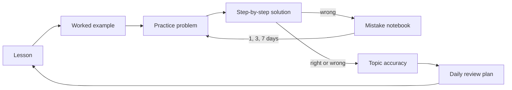

# Rev.U Build Plan

A review web app for the Civil Engineering licensure exam. It teaches each topic through lessons and step-by-step solutions, then brings back what a reviewer got wrong until it is cleared.

Written 21 November 2026. The design is recorded in [design-system/](design-system/README.md), with a working prototype in [design-system/prototype.html](design-system/prototype.html).

## Scope

**Who it is for:** candidates reviewing for the Civil Engineering board exam, on a phone, tablet or laptop, often alongside a review center.

**The job:** make a topic such as Trigonometry easy to understand, and make sure missed problems are seen again until they stick.

### Decisions already made

- Civil Engineering first, starting with the mathematics topics and Trigonometry as the template.
- No AI model in the app, so there is no per-use cost.
- Lessons and problems are authored content with step-by-step solutions.
- PDF upload is a personal library: stored, tagged to a topic and read in the app, with nothing extracted from it.
- Mistake notebook and spaced repeats are in version 1.
- A scratch pad for solving by hand is in version 1.
- Web app, responsive for phone, tablet and laptop.
- The interface is the Daily Desk design: the app opens on today's work with one clear next action.

| In version 1 | After version 1 | Not planned |
|---|---|---|
| Sign-up and exam date | Formula sheet per topic | AI tutor or AI extraction |
| Lessons with rendered math | Readiness meter against the pass marks | Payments |
| Practice with step-by-step reveal | Wrong-choice explanations | Native mobile app |
| Hint before the solution | Calculator technique notes | Admin content editor |
| Scratch pad, with full screen | Saving scratch work to the notebook | Discussion threads |
| Progress per topic and subject | Mixed-topic sets and pace timer | Leaderboards and badges |
| Mistake notebook | Bookmarks and notes | |
| Spaced repeats | Interactive figures | |
| Daily review plan and streak | Offline use | |
| Timed mock exam | Dark theme | |
| PDF personal library | | |

## Exam facts the app depends on

The PRC website refused connections on the day this was researched. Rows marked unconfirmed come from review sites and must be checked against the PRC exam program and Table of Specifications before the topic list and mock exam are fixed.

| Fact | What the sources say | Status |
|---|---|---|
| Subjects | Three: Mathematics, Surveying and Transportation Engineering; Hydraulics and Geotechnical Engineering; Structural Engineering and Construction | Unconfirmed names |
| Weights | 35 / 30 / 35 on current review sites. A 2009 Board resolution set 33⅓ each from November 2013. | Conflict |
| Pass mark | 70% general average, no subject below 50% | Unconfirmed |
| Math topics | Algebra, plane and spherical trigonometry, analytic geometry, solid mensuration, calculus, differential equations, probability and statistics | Read in the 2009 resolution |
| Items and time per subject | Not retrieved | Unknown |
| Calculators | 96 allowed models under PRC Resolution 1809 (2024). Casio fx-991ES and fx-991ES PLUS are banned; two of three sites also list fx-570ES PLUS as banned. | Unconfirmed |

## How it works

A reviewer reads a short lesson, studies a worked example, then solves problems. Each solution opens one step at a time, so they can attempt the next step before seeing it. Every wrong answer goes into the mistake notebook and returns on a schedule.



### Spaced repeat rule

- A wrong answer puts the problem in the notebook, due the next day.
- A correct answer on a due repeat moves it on: 1 day, then 3 days, then 7 days.
- A correct answer at 7 days clears it from the notebook.
- A wrong answer at any point sends it back to 1 day.
- Mock exam mistakes enter the notebook the same way.

### Daily review plan rule

- All repeats due today come first.
- Then new problems from the weakest topics, ranked by `(1 − accuracy) × subject weight`.
- A topic with fewer than 5 answers counts as unknown and is ranked ahead of known-strong topics.
- The daily target is the number of unseen problems divided by the days left to the exam.

The intervals and the weighting are starting values, to be adjusted after the pilot.

### Scratch pad

- A drawing surface on the problem screen with pen, eraser, undo and clear, for finger, stylus or mouse.
- On a phone it slides up as a sheet. On tablet and laptop it sits beside the problem.
- It can be opened full screen at any width. The problem text and its figure stay in a strip at the top.
- Version 1 does not save the working. It stays while the reviewer is on that problem and clears on the next one.

### Screens

| Screen | What the reviewer does there |
|---|---|
| Sign in and setup | Creates an account and sets the exam date |
| Today | Starts due repeats, sees the next stops of the day, the daily target, the streak and the week's activity |
| Subjects and topics | Browses the three subjects and their topics with accuracy for each |
| Lesson | Reads the concept, formulas and worked examples for one topic |
| Problem | Answers, asks for a hint, works on the scratch pad, then reveals the solution one step at a time |
| Set summary | Sees what moved forward and what comes back |
| Mistake notebook | Reviews missed problems, grouped by when they are due |
| Mock exam | Sits a timed set for one subject and gets results at the end |
| Library | Uploads PDFs, tags them to a topic and reads them |

## Build

### Stack

- **Next.js with TypeScript and Tailwind:** one app, no separate backend.
- **Supabase:** database, sign-in, file storage and per-user access rules.
- **KaTeX:** renders the math in lessons and solutions.
- **Lucide:** one open-source icon set, so every icon shares a weight and corner style.
- **Vercel:** hosting.

### Data

| Table | Holds | Who can read it |
|---|---|---|
| `profiles` | User, exam date | Owner only |
| `exams` | Exam name (Civil Engineering for now) | Any signed-in user |
| `topics` | Subject, topic name, subject weight, lesson text | Any signed-in user |
| `questions` | Topic, problem text, choices, correct choice, hint, solution steps, optional figure | Any signed-in user |
| `attempts` | User, mode (practice, repeat or mock), start and finish times | Owner only |
| `answers` | Attempt, question, chosen option, correct or not | Owner only |
| `repeats` | User, question, current interval, due date | Owner only |
| `documents` | User, topic, title, stored PDF | Owner only |

Content tables are written only by the import script. Uploaded PDFs go to a private storage folder per user, limited to PDF files with a size cap and a per-user quota.

The streak, daily ring, week chart, answer feedback and set summary all read from `attempts`, `answers` and `repeats`. None of them needs its own table.

### Phases

Sizes are relative effort, not dates.

| # | Phase | Size | Done when | Check |
|---|---|---|---|---|
| 1 | Foundation: app, sign-in, tables, access rules, design tokens | Medium | A user can sign up and set an exam date | Test that one user cannot read another's rows |
| 2 | Lesson page with math | Small | The Trigonometry lesson reads cleanly on a phone | Viewed on a real phone |
| 3 | Practice with hint and step-by-step solutions | Medium | A reviewer can work 20 trig problems and reveal the steps | Answers are saved correctly |
| 3b | Scratch pad on the problem screen | Small | A reviewer can work a problem by hand; sheet on a phone, side panel on wider screens, full screen on request | Tried on a real phone and a tablet |
| 4 | Content import | Small | Adding a topic needs no code change | Import rejects a problem with no correct choice or no solution |
| 5 | Progress | Small | Accuracy shows per topic and subject | Numbers match a hand count |
| 6 | Mistake notebook and spaced repeats | Medium | A wrong answer appears in the notebook and returns on schedule | Unit test of the interval rule |
| 7 | Today: daily review plan, streak, week chart | Small | Today shows due repeats first, then the weakest topics | Unit test of the ranking |
| 8 | Mock exam | Medium | A timed set per subject with results at the end | Timer survives a page refresh |
| 9 | PDF library | Small | A reviewer can upload, tag and read a PDF | Non-PDF and oversized files are refused |
| 10 | Pilot with 5–10 reviewees | — | Feedback collected and ranked | — |

Phases 2 and 3 are finished only when Trigonometry works end to end. Every screen is built to the three layouts in the design system: phone, tablet and laptop.

### Running costs

Hosting and storage only. Supabase and Vercel have free tiers that should cover the pilot; their current limits were not checked. Stored PDFs are the first thing likely to outgrow them.

## Content

Content is the slowest part of the project. Each topic needs one lesson and a set of problems, and every problem needs a one-line hint and a solution broken into steps.

- **First:** Trigonometry, one lesson per sub-topic and 20 problems, ready before phase 3 ends.
- **Before the pilot:** the remaining math topics, about 200 problems in total.
- **After the pilot:** surveying and transportation, then the other two subjects.
- **Review:** a licensed civil engineer checks every solution before it is published.

### Problem file format

Authors write plain text files. A line of three dashes separates the solution steps.

```text
topic: trigonometry/angles-of-elevation
answer: C
hint: Start with the right triangle at B. Write h in terms of the distance from B to the tower.

From point A, the angle of elevation of the top of a tower is 30°.
From point B, 40 m closer to the tower, it is 60°. Find the height.

A. 20.00 m    B. 28.28 m    C. 34.64 m    D. 40.00 m

## Solution
Let $x$ be the distance from B to the tower and $h$ its height.
---
From B: $\tan 60° = h / x$, so $h = \sqrt{3}\,x$.
---
From A: $\tan 30° = h / (x + 40)$, so $x + 40 = 3x$ and $x = 20$ m.
---
$h = 20\sqrt{3} \approx 34.64$ m.
```

## Risks

| Risk | Effect | What the plan does about it |
|---|---|---|
| Nobody is assigned to write content | The app launches empty | Decide the author before phase 3; Trigonometry first proves the pace |
| A published solution is wrong | Reviewers learn the wrong method | A licensed civil engineer checks every solution |
| Exam weights and topics are unconfirmed | Review plan and mock exams are weighted wrongly | Weights are stored as data, so they change without code |
| Uploaded PDFs are copyrighted review material | Legal exposure if shared | Uploads stay private to the uploader, with no sharing feature |
| PDF storage grows past the free tier | A monthly bill appears | Size cap and per-user quota from day one |
| Calculator notes name a banned model | Reviewers buy the wrong calculator | Notes wait until the PRC list is confirmed |

## Open decisions

1. **Content author:** you, a civil engineering instructor, or licensed material. This sets the pace of everything after phase 4.
2. **Exam facts:** open the current PRC exam program and Table of Specifications and confirm the weights, items per subject and time limits.

## Sources

- [Board of Civil Engineering Resolution No. 08, s. 2009](https://elibrary.judiciary.gov.ph/thebookshelf/showdocs/10/55289) (read)
- [PRC 2022 Table of Specifications](https://www.prc.gov.ph/sites/default/files/2022-01%20published%20TOS%20Civil%20Engineering.pdf) and [September 2026 exam program](https://www.prc.gov.ph/sites/default/files/exam%20program%20Sept%202026%20(CE).pdf) (unreachable, to be checked)
- [supertutor.ph](https://supertutor.ph/resources/blog/licensure-exams/cele-overview/) and [reviewersph.com](https://reviewersph.com/prev/ce-coverage) on subjects and weights
- [topnotcher.ph](https://topnotcher.ph/prc-list-of-allowed-calculator-models/) and [slrcreview.com](https://www.slrcreview.com/2026/09/prc-allowed-non-programmable-calculators.html) on allowed calculators
- [Worked-example effect](https://en.wikipedia.org/wiki/Worked-example_effect) and [Dunlosky on practice testing and spaced practice](https://www.aft.org/ae/fall2013/dunlosky)
- [KaTeX](https://katex.org/docs/supported) and [Supabase with Next.js](https://supabase.com/docs/guides/auth/quickstarts/nextjs)
- Dribbble references for the interface, matched from titles and descriptions only: [Spaced repetition app](https://dribbble.com/shots/15426592-Spaced-repetition-app), [Flashcard App](https://dribbble.com/shots/4908154-Flashcard-App), [AI Daily Quiz](https://dribbble.com/shots/25889270-Mobile-App-AI-Daily-Quiz), [Learning Path and Quiz](https://dribbble.com/shots/22491397-E-Learning-Learning-Path-and-Quiz-Mobile-App)
